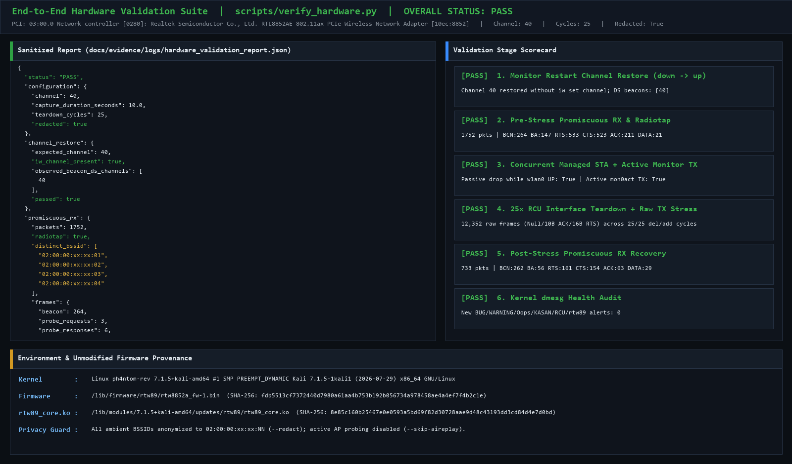

# rtw89: исправления режима монитора и инъекции кадров (Принято в `rtw-next`)

[](https://github.com/ph4ntom-rev/rtw89-monitor-injection/actions/workflows/ci.yml)
[](https://lore.kernel.org/linux-wireless/63269466-8c67-461e-a29b-f64bb0d47f6a@RTKEXHMBS05.realtek.com.tw/)
[](LICENSE)

**[English](README.md) | [Русский](README_RU.md) | [Архитектура](docs/ARCHITECTURE.md) | [Проверка и доказательства](docs/PREFLIGHT_VALIDATION.md)**

Патчи для драйвера `rtw89` из основного ядра Linux (Realtek RTL8851B/8852A/8852B/8852C/8922A).
Исправляют аппаратный RX-фильтр в режиме монитора (включая сохранение фильтра после
сканирования, ROC и реинициализации MAC и сохранение аппаратного Auto-ACK при совместной
работе со станцией), включают инъекцию сырых 802.11-кадров (`aireplay-ng`, radiotap TX,
`DATA_RETRIES`, `NO_ACK`) как на отдельном, так и на активном (`MONITOR_FLAG_ACTIVE`)
monitor-интерфейсе, и восстанавливают рабочий канал при выходе из `IDLE` после перезапуска
интерфейса монитора. Прошивка не изменяется.

## Состояние

| | |
| :--- | :--- |
| Статус в апстриме | **Смержено в `pkshih/rtw.git` `rtw-next`** (2026-11-22, [уведомление в lore](https://lore.kernel.org/linux-wireless/63269466-8c67-461e-a29b-f64bb0d47f6a@RTKEXHMBS05.realtek.com.tw/)) и `wireless-next` (`rtw-next-2026-11-23`): коммиты [`0202cb50fe9f`](https://github.com/pkshih/rtw/commit/0202cb50fe9fba862bd1cbc8079b56c9b29a2c4f)..[`92608bb5f14f`](https://github.com/pkshih/rtw/commit/92608bb5f14f4c6f18c987055c5dfd51771ea51d) (`+42/-4`). |
| Follow-up серия | [`[PATCH rtw-next v2 0/2]`](https://lore.kernel.org/linux-wireless/20261127101307.15-1-owner@ph4ntom-rev.uz/) отправлена в `linux-wireless` (2026-11-27; Patchwork [`#15029212`](https://patchwork.kernel.org/project/linux-wireless/patch/20261127101307.15-2-owner@ph4ntom-rev.uz/), [`#15029213`](https://patchwork.kernel.org/project/linux-wireless/patch/20261127101307.15-3-owner@ph4ntom-rev.uz/), `delegate=pkshih`); локальные патчи в [`patches/followup-v2/`](patches/followup-v2/) поверх [`18d0bedbb5f0`](https://github.com/pkshih/rtw/commit/18d0bedbb5f0538396cb7f763ed9cd1dd69c5b23). |
| Рассылка (v8) | [`[PATCH rtw-next v8 0/5]`](https://lore.kernel.org/linux-wireless/20261119080328.391-1-owner@ph4ntom-rev.uz/) (`5/5 Acked-by: Ping-Ke Shih`, `3/5 Reviewed-by: Zong-Zhe Yang`); локальные патчи в [`patches/v8/`](patches/v8/) поверх [`0bdc579dbfc2`](https://github.com/pkshih/rtw/commit/0bdc579dbfc251a6b6838ee9459b6771b948c617). |
| Сборка и статика | Каждый патч собирается отдельно; `W=1` и sparse (`C=1`) с `CONFIG_PROVE_LOCKING=y` дают `0` новых предупреждений; `checkpatch.pl --strict` — `0` ошибок/предупреждений; `patch_rtw89.py` проверяется на `v6.1`, `v6.6`, `v6.12` (Gen 1), `v6.15`, `v6.18` (Gen 2) и `v7.4-rc1` с реальной Kbuild-сборкой `make W=1 C=1 modules` на LTS `v6.6`, `v6.12`, `v6.18` и `v7.4-rc1` в [CI](.github/workflows/ci.yml). |
| Проверка на железе | **RTL8852AE** (`10ec:8852`, прошивка `rtw89/rtw8852a_fw-1.bin` `0.13.36.2`, Linux `7.1.5+kali-amd64`) — верифицирована в IDA Pro 9.5 и протестирована вживую через `tracefs`/kprobes + `verify_hardware.py` (`PASS`), см. [отчёт и скриншоты](docs/PREFLIGHT_VALIDATION.md). |
| Не проверено на железе | RTL8852B/C/BT, RTL8851B, RTL8922A/D (Wi-Fi 7), USB-адаптеры, DBCC. |

## Серия v8

| # | Коммит (`rtw-next`) | Патч | Тип |
| :-- | :--- | :--- | :--- |
| 1 | [`0202cb50fe9f`](https://github.com/pkshih/rtw/commit/0202cb50fe9fba862bd1cbc8079b56c9b29a2c4f) | `wifi: rtw89: avoid NULL vif dereference in rtw89_ops_tx()` | исправление (`vif_to_rtwvif_safe()`), `Fixes:` + `Cc: stable` |
| 2 | [`260247bfbc5b`](https://github.com/pkshih/rtw/commit/260247bfbc5ba536ab889eb04e31aa3b990ac2bc) | `wifi: rtw89: handle negative rate index for injected frames` | исправление (`max_t(s8, ..., 0)`), `Fixes:` + `Cc: stable` |
| 3 | [`e07c9af7bbc8`](https://github.com/pkshih/rtw/commit/e07c9af7bbc877a819f11750eb899b4abe271aeb) | `wifi: rtw89: restore channel when leaving idle on non-chanctx devices` | исправление (`rtwdev->support_chanctx` + `CONF_CHANGE_CHANNEL`) |
| 4 | [`4175fc84dbe9`](https://github.com/pkshih/rtw/commit/4175fc84dbe9680c7a4ab18aa7fa48b7e3bdede1) | `wifi: rtw89: avoid reading seq_ctrl on control frames` | исправление (`ieee80211_is_ctl()`) |
| 5 | [`92608bb5f14f`](https://github.com/pkshih/rtw/commit/92608bb5f14f4c6f18c987055c5dfd51771ea51d) | `wifi: rtw89: honor ASSIGN_SEQ, retries, and NO_ACK for injected frames` | инъекция (`!ASSIGN_SEQ`, `NO_ACK`, `max_rate_tries`) |

### Follow-up исправления (`patches/followup-v2/`)

| # | Lore (`linux-wireless`) | Патч | Тип |
| :-- | :--- | :--- | :--- |
| 1 | [`1/2`](https://lore.kernel.org/linux-wireless/20261127101307.15-2-owner@ph4ntom-rev.uz/) | `wifi: rtw89: fix retry limit and NO_ACK status for injected frames` | исправление (`RATE_INJECT`, `min(0x3f, IEEE80211_MAX_TX_RETRY)`, `NO_ACK` в `mac.h`), `Fixes: 92608bb5f14f` |
| 2 | [`2/2`](https://lore.kernel.org/linux-wireless/20261127101307.15-3-owner@ph4ntom-rev.uz/) | `wifi: rtw89: pci: fix NO_ACK TX status reporting` | исправление (`NOACK_TRANSMITTED` vs `ACK` и лог ошибок TX в `pci.c`) |

Подробное описание каждого патча, out-of-tree слоя `rtw89_mon`, логов и скриншотов приведено в
[docs/ARCHITECTURE.md](docs/ARCHITECTURE.md),
[cover letter](patches/v8/v8-0000-cover-letter.patch) и
[docs/PREFLIGHT_VALIDATION.md](docs/PREFLIGHT_VALIDATION.md).



> [!NOTE]
> **Пассивный и активный monitor-интерфейсы:** Пассивный монитор (`iw ... type monitor` без
> `flags active`) передаёт кадры только тогда, когда он является единственным открытым
> интерфейсом на карте; если параллельно поднят интерфейс станции или точки доступа, кадры с
> пассивного монитора безопасно отбрасываются. Для одновременной инъекции при активном
> `wlan0` (с сохранением аппаратного Auto-ACK) создайте активный монитор
> (`NL80211_FEATURE_ACTIVE_MONITOR`):
> `sudo iw dev wlan0 interface add mon0act type monitor flags active otherbss`.

## Использование

### A. Дерево ядра mainline / wireless-next

```bash
cd linux
git am /path/to/rtw89-monitor-injection/patches/v8/v8-00*-wifi-*.patch
```

Локальная предпроверка серии перед отправкой (`checkpatch.pl --strict`, проверка тегов и
генерация команды `--dry-run` без реальной отправки писем):

```bash
bash scripts/prepare_submission.sh --kernel-dir /path/to/linux
```

### B. Ядро дистрибутива, разовая сборка

`scripts/patch_rtw89.py` переносит изменения `v5` в исходники `rtw89` ядра дистрибутива
(`Linux 6.1 - 7.x`) и завершается с явной ошибкой, если любой обязательный хук не найден.

```bash
sudo apt install linux-headers-$(uname -r) linux-source build-essential python3
mkdir -p ~/rtw89_src
tar -xf /usr/src/linux-source-*.tar.xz --strip-components=6 -C ~/rtw89_src \
    --wildcards '*/drivers/net/wireless/realtek/rtw89/*'

bash scripts/build_module.sh --rtw89-dir ~/rtw89_src --install
```

`build_module.sh` спрашивает подтверждение перед выгрузкой работающего драйвера (Wi-Fi
ненадолго пропадёт); `--yes` отключает вопрос. Все модули `rtw89` устанавливаются вместе в
`/lib/modules/$(uname -r)/updates/rtw89`, чтобы ядро драйвера, модуль шины и модули чипов
всегда собирались из одних исходников. Откат: `bash scripts/build_module.sh --uninstall`.

**Secure Boot:** неподписанные модули ядро не загрузит. Скрипт определяет Secure Boot через
`mokutil` и останавливается до выгрузки драйвера. Подпись зарегистрированным MOK-ключом:

```bash
bash scripts/build_module.sh --rtw89-dir ~/rtw89_src --install \
    --sign-key /var/lib/shim-signed/mok/MOK.priv --sign-cert /var/lib/shim-signed/mok/MOK.der
```

### C. Ядро дистрибутива через DKMS

```bash
bash scripts/dkms_prepare.sh --source /usr/src/linux-source-7.1.tar.xz
sudo dkms install rtw89-monitor-injection/5.0
```

`dkms_prepare.sh` ограничивает `BUILD_EXCLUSIVE_KERNEL` серией `MAJOR.MINOR` исходного ядра
(поддерживая как релизные, так и `-rc` версии). После перехода на новую серию ядра
запустите `dkms_prepare.sh` повторно с соответствующим архивом `linux-source`. Удаление:
`bash scripts/dkms_prepare.sh --remove`.

### Режим монитора и инъекция

```bash
# Отдельный monitor-интерфейс
sudo ip link set wlan0 down
sudo iw dev wlan0 set type monitor
sudo ip link set wlan0 up
sudo iw dev wlan0 set freq 2412
sudo tcpdump -i wlan0 -e -c 30

# Или совместный активный монитор параллельно с управляемым wlan0
sudo iw dev wlan0 interface add mon0act type monitor flags active otherbss
sudo ip link set dev mon0act address 02:00:00:88:52:10
sudo ip link set mon0act up
```

## Структура репозитория

```text
patches/followup-v2/   v2 follow-up серия из 2 патчей + cover letter поверх rtw-next (18d0bedbb5f0)
patches/followup-v1/   предыдущая follow-up серия v1, сохранена для истории
patches/v8/            смерженная апстрим-серия из 5 патчей + cover letter (5/5 Acked-by)
patches/v2..v7/        предыдущие версии, сохранены для истории
src/rtw89_mon.{c,h}    вспомогательный модуль, подключаемый к rtw89_core через patch_rtw89.py
scripts/               patch_rtw89.py, build_module.sh, dkms_prepare.sh, dkms_pre_build.sh,
                       prepare_submission.sh, verify_hardware.py, verify_monitor_diag.py
dkms/dkms.conf.in      шаблон DKMS для dkms_prepare.sh
tests/                 юнит-тесты интегратора и гигиены серии патчей
docs/                  архитектура, отчёт о проверке на железе и каталог evidence/
```

## Правовые вопросы и регулирование

- Репозиторий не содержит прошивок и кода вендора; используется штатная подписанная
  прошивка из `linux-firmware`.
- Регуляторные домены, ограничения мощности, флаги DFS и `NO_IR` не изменяются. Вы сами
  отвечаете за соблюдение местных правил использования радиочастот и за то, чтобы
  передавать кадры только в сетях, на тестирование которых у вас есть разрешение.
- Двойная лицензия `GPL-2.0-only OR BSD-3-Clause`, как у драйвера в ядре
  ([LICENSE](LICENSE), [LICENSES/](LICENSES/)).
- Realtek является товарным знаком Realtek Semiconductor Corp. Проект не связан с Realtek.
