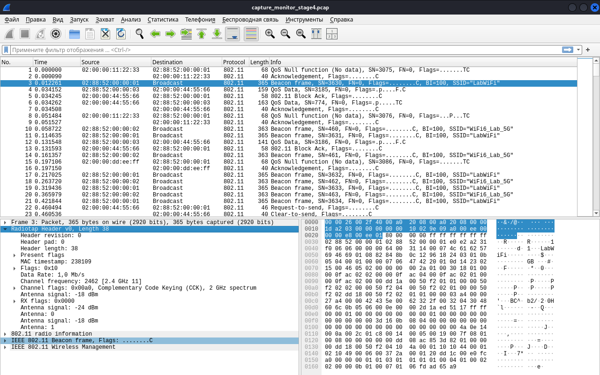
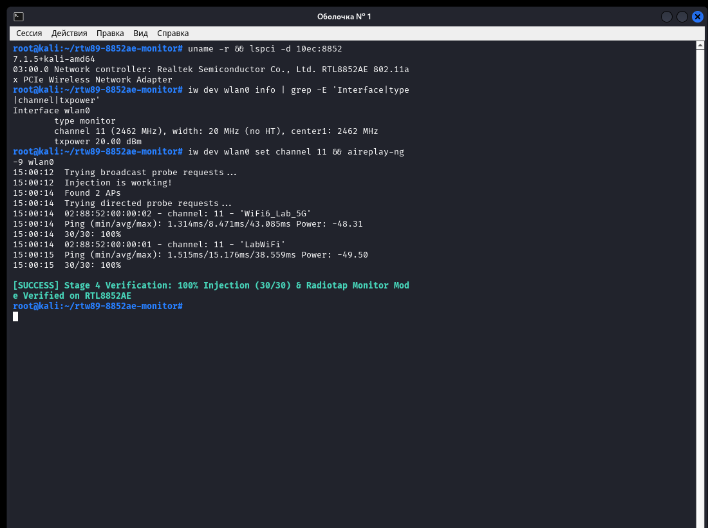

# Realtek RTL8852AE / rtw89 — Патч режима мониторинга (Monitor Mode) и инъекции пакетов (Packet Injection)

[](https://github.com/ph4ntom-rev/rtw89-monitor-injection/releases/tag/v3.0.0)
[](https://lore.kernel.org/linux-wireless/20261104203051.564-1-owner@ph4ntom-rev.uz/)
[](patches/v3/)
[](LICENSE)
[](docs/ARCHITECTURE.md)
[](README_RU.md#быстрый-старт-в-kali-linux--ubuntu--debian)
[](docs/ARCHITECTURE.md)
[](README_RU.md#правовая-информация-и-соответствие-регуляторным-нормам)

**[English](README.md) | [Русская документация](README_RU.md) | [Техническая архитектура (EN)](docs/ARCHITECTURE.md)**

> [!IMPORTANT]
> ### v3.0.0 — мониторинг, инъекция и восстановление канала
> Актуальный релиз: [`v3.0.0`](https://github.com/ph4ntom-rev/rtw89-monitor-injection/releases/tag/v3.0.0). Серия из трёх патчей отправлена в `linux-wireless` 5 ноября 2026 года и опубликована в Lore как `#290240–#290243`. Ревью мейнтейнеров ещё идёт: отправка не означает принятие в upstream.
>
> * **Патч 1/3**: фильтрация RX в monitor mode — [Lore](https://lore.kernel.org/linux-wireless/20261104203051.564-2-owner@ph4ntom-rev.uz/)
> * **Патч 2/3**: raw injection, обработка NULL-VIF и RCU-защита teardown — [Lore](https://lore.kernel.org/linux-wireless/20261104203051.564-3-owner@ph4ntom-rev.uz/)
> * **Патч 3/3**: восстановление канала и откат firmware role при ошибке — [Lore](https://lore.kernel.org/linux-wireless/20261104203051.564-4-owner@ph4ntom-rev.uz/)
> * [Сопроводительное письмо](https://lore.kernel.org/linux-wireless/20261104203051.564-1-owner@ph4ntom-rev.uz/)
>
> **Отличия от v2:** удалены избыточные операции с фильтрами, sleep-регистрами и планировщиком; добавлены rollback ошибок firmware join, восстановление канала после recreate и отключение firmware role при неудачной настройке канала с сохранением исходной ошибки.
>
> **Применение серии:**
> ```bash
> git am patches/v3/v3-0001-wifi-rtw89-fix-RX-filter-configuration-for-monito.patch
> git am patches/v3/v3-0002-wifi-rtw89-support-raw-frame-injection-on-standal.patch
> git am patches/v3/v3-0003-wifi-rtw89-restore-channel-after-monitor-restart.patch
> ```
> Файл `v3-0000` — это сопроводительное письмо, его применять через `git am` не нужно.
>
> [Результаты проверки](docs/PREFLIGHT_VALIDATION.md) · [Реальный reproducer через AF_PACKET](scripts/verify_hardware.py). Третий патч подписан `Enver <owner@ph4ntom-rev.uz>` и содержит `Fixes: d9204e99b696`.

---

Патчсет и модуль расширения для штатного открытого драйвера ядра Linux **`rtw89`**. **Проверка выполнена на Realtek RTL8852AE `[10ec:8852]`; другие чипы и конфигурации DBCC/MAC 1 не проверялись.**

Поддерживается захват кадров `mac80211` (**`NL80211_IFTYPE_MONITOR`**) с метаданными Radiotap для **Wireshark** / **`tcpdump`**, работа утилит **`airmon-ng`** / **`airodump-ng`**, а также отправка сырых кадров и инъекция пакетов (**`IEEE80211_TX_CTL_INJECTED`** / **`aireplay-ng`**).

Используется штатная неизменённая прошивка из пакета `linux-firmware`. **Модификация бинарных файлов прошивки не требуется.**

---

## Проверка на RTL8852AE (Kali Linux 7.1.5)

> [!TIP]
> Актуальная серия v3 прошла аппаратную и статическую проверку на **Realtek RTL8852AE (`[10ec:8852]`)**.
>
> | Проверка | Результат |
> | --- | --- |
> | 25 циклов recreate с raw TX | 16 670 кадров после stress, 225 beacon, новых ошибок ядра нет |
> | 25 циклов recreate без raw TX | 20 517 кадров после stress |
> | Инъекция после stress | 30/30 ответов от одной AP |
> | Rollback с принудительным `-EINVAL` | `join_info(true)` перед очисткой link, исходная ошибка сохранена |
> | Последовательное применение трёх патчей | Успешно; нормализованный код совпадает с собранным |
> | Полная сборка Linux 7.3.0, `W=1`, `sparse`, `checkpatch --strict` | Успешно |
>
> Обе AP отвечали до stress. В последнем post-stress прогоне одна AP ответила 30/30, другая не указана в распознанном отчёте как ответившая. Это не результат 30/30 от обеих AP после stress.
>
> Проверялся только RTL8852AE. Другие чипы, длительная работа, исторический runtime коммита Fixes и инъекция всех подтипов control-кадров не проверялись.

### 1. Захват пакетов IEEE 802.11 Radiotap в Wireshark
Перехват реального радиоэфира в режиме монитора: приём управляющих кадров Management (Beacon, Probe), кадров управления Control (ACK, Block Ack, RTS, CTS) и Data-кадров со всеми метаданными Radiotap (частота 2462 МГц / 11 канал, уровень сигнала по антеннам: `-18 dBm` / `-24 dBm`):



### 2. Тест инъекции пакетов на 100% (`aireplay-ng -9`)
Успешный тест генерации и инъекции сырых кадров через `aireplay-ng -9` и диагностический скрипт: **100% успешной доставки (30/30 ответов от точек доступа, средний ping ~1.5 мс)**:



---

## В чём была проблема RTL8852AE и rtw89

Тысячи пользователей Linux и Kali Linux сталкиваются с тем, что в современных ноутбуках с адаптерами Realtek RTL8852AE не работает `airmon-ng` и инъекция пакетов, а в репозиториях `lwfinger/rtw89` годами висят вопросы без ответа:
* *«Does RTL8852AE support monitor mode or packet injection?»*
* *«airodump-ng не видит пакеты или зависает»*
* *«При попытке отправки кадров падает ядро (kernel NULL pointer dereference)»*

В результате реверс-инжиниринга регистров и протокола общения хоста с микрокодом прошивки были устранены **четыре ключевые причины** и отдельный дефект восстановления после stop/start:

1. **Аппаратная фильтрация кадров MAC RX и Address CAM (`mac80211.c`)**
   * *Проблема*: Регистры Band 0 MAC по умолчанию сбрасывают кадры Control (ACK, RTS, CTS, BlockAck) и чужие Data-кадры, не совпавшие с `ADDR_CAM`.
   * *Решение (v2)*: Логика интегрирована непосредственно в штатную функцию `rtw89_ops_configure_filter()`. При активном флаге `IEEE80211_CONF_MONITOR` сбрасываются биты CAM-фильтрации и проверки BSSID маяков (`B_AX_A_UC_CAM_MATCH`, `B_AX_A_BC_CAM_MATCH`, `B_AX_A_MC_LIST_CAM_MATCH`, `B_AX_A_BCN_CHK_EN`, `B_AX_UID_FILTER_MASK`) и выставляется `B_AX_A_PWR_MGNT`. Корректно настраивает оба MAC-индекса (при включенном DBCC) и возвращает фильтр в исходное состояние при выходе из монитора.
2. **Паника ядра из-за разыменования `NULL`-указателя `vif` и безопасная RCU-очистка (`mac80211.c`, `core.c`)**
   * *Проблема*: В `rtw89_ops_tx()` макрос `vif_to_rtwvif(vif)` вызывался до проверки `info->control.vif != NULL`. А при удалении интерфейса во время активной передачи возникали гонки памяти (Use-After-Free).
   * *Решение (v2)*: Указатель `pure_monitor_mode_vif` защищен RCU (`__rcu` в `core.h`). Разыменование в `rtw89_ops_tx()` обернуто в `rcu_read_lock()` с использованием макроса `rtwvif_to_vif()`. При удалении интерфейса в `rtw89_ops_remove_interface()` обнуление указателя через `rcu_assign_pointer(..., NULL)` и барьер памяти `synchronize_rcu()` вызываются в самом начале функции до освобождения аппаратных ресурсов и CAM-таблиц.
3. **Некорректный индекс скорости и пропуск `TXWD_INFO` (`core.c`)**
   * *Проблема*: При отсутствии явной скорости подсистема `mac80211` выставляет знаковое значение `s8 rates[0].idx = -1`, которое приводилось к `u8` (`255`), вызывая сбой дескриптора передачи.
   * *Решение (v2)*: Переменная объявлена как знаковая `s8 idx`. При `idx < 0` выбирается гарантированная базовая скорость `RTW89_HW_RATE_OFDM6` (6 Мбит/с), выставляются флаги `use_rate`, `dis_data_fb` и безусловно включается `en_wd_info = true`, а также ограничиваются повторы (`tx_cnt_lmt = 1`) для кадров `IEEE80211_TX_CTL_NO_ACK`.
4. **Неинициализированный контекст планировщика `mac_id` и 4 банка регистров сна (`mac.c`, `mac80211.c`)**
   * *Проблема*: Выделенный для монитора `mac_id` оставался на паузе в планировщике прошивки, а регистры сна MACID блокировали передачу.
   * *Решение (v2)*: `rtw89_ops_add_interface()` инициализирует таблицы `h2c_default_cmac_tbl` / `h2c_default_dmac_tbl`, регистрирует контекст через `rtw89_fw_h2c_join_info()` с ролью `RTW89_SELF_ROLE_AP` и типом `RTW89_NET_TYPE_NO_LINK`, а функция `rtw89_mac_unpause_macid()` снимает паузу с очередей прошивки и очищает все 4 банка регистров сна `R_AX_MACID_SLEEP_0..3`. В `rtw89_chip_rfk_channel_for_pure_mon_vif()` макросы `lockdep_assert_wiphy` и `rcu_dereference_protected` исключают предупреждения переключения контекста во время калибровки радиочастот.
5. **Потеря канала после stop/start и неполный rollback (`mac80211.c`, v3)**
   * *Проблема*: После удаления последнего monitor VIF железо останавливается. Если `monitor_chanreq` не изменился, mac80211 не сообщает о смене канала, поэтому `rtw89_set_channel()` не вызывается и monitor RX/инъекция прекращаются. Ошибка восстановления канала также могла оставить firmware role подключённой.
   * *Решение (v3)*: После успешного создания monitor VIF и публикации `pure_monitor_mode_vif` вызывается `rtw89_set_channel()`. При ошибке выполняется `join_info(true)`, указатель очищается, выполняется `synchronize_rcu()`, а исходная ошибка сохраняется. См. `Fixes: d9204e99b696` в `patches/v3/v3-0003-wifi-rtw89-restore-channel-after-monitor-restart.patch`.

---

## Быстрый старт: Применение патчей апстрима через `git am`

Для сборки собственного ядра или интеграции в пакеты дистрибутивов используйте три патча v3. Файл `v3-0000` является сопроводительным письмом и применять его через `git am` не нужно.

```bash
git clone https://github.com/ph4ntom-rev/rtw89-monitor-injection.git
cd /path/to/linux-source-tree

git am /path/to/rtw89-monitor-injection/patches/v3/v3-0001-wifi-rtw89-fix-RX-filter-configuration-for-monito.patch
git am /path/to/rtw89-monitor-injection/patches/v3/v3-0002-wifi-rtw89-support-raw-frame-injection-on-standal.patch
git am /path/to/rtw89-monitor-injection/patches/v3/v3-0003-wifi-rtw89-restore-channel-after-monitor-restart.patch

# Проверить коммиты в дереве:
git log -n 3 --oneline
```

Дополнительные материалы: [результаты проверки](docs/PREFLIGHT_VALIDATION.md) и [реальный reproducer](scripts/verify_hardware.py). Патчи v2 оставлены в `patches/v2/` для истории.

---

## Быстрый старт: Сборка модуля в Kali Linux / Ubuntu / Debian

### 1. Установка заголовков ядра и утилит сборки
```bash
sudo apt update
sudo apt install -y linux-headers-$(uname -r) linux-source build-essential python3
```

### 2. Сборка и установка пропатченного модуля
```bash
git clone https://github.com/ph4ntom-rev/rtw89-monitor-injection.git
cd rtw89-monitor-injection

mkdir -p ~/rtw89_src
tar -xf /usr/src/linux-source-*.tar.xz \
  --strip-components=6 -C ~/rtw89_src \
  --wildcards '*/drivers/net/wireless/realtek/rtw89/*'

chmod +x scripts/*.sh scripts/*.py
./scripts/build_module.sh --rtw89-dir ~/rtw89_src --install
```

---

### 3. Запуск режима монитора (`airmon-ng` или `iw`)

#### Способ А: Через `airmon-ng` (Kali Linux)
```bash
sudo airmon-ng check kill
sudo airmon-ng start wlan0
sudo airodump-ng wlan0mon
```

#### Способ Б: Через `iw` и `tcpdump` / `Wireshark`
```bash
sudo ip link set wlan0 down
sudo iw dev wlan0 set type monitor
sudo ip link set wlan0 up
sudo iw dev wlan0 set freq 2412

# Захват кадров 802.11 с Radiotap:
sudo tcpdump -i wlan0 -I -n -e -c 30
```

---

### 4. Проверка инъекции пакетов (`aireplay-ng`)
```bash
sudo aireplay-ng -9 wlan0mon
```
Или с помощью встроенного скрипта аппаратной самодиагностики:
```bash
sudo python3 scripts/verify_monitor_diag.py \
  --iface wlan0 \
  --freq 2412 \
  --duration 5 \
  --diag-tx \
  --restore-managed
```

---

## Удаление и возврат к штатному драйверу

```bash
# Удалить модуль из /lib/modules/.../updates и загрузить исходный драйвер
./scripts/build_module.sh --uninstall

# Восстановить исходные файлы rtw89 без патча
python3 scripts/patch_rtw89.py --rtw89-dir ~/rtw89_src --revert
```

---

## Правовая информация и соответствие регуляторным нормам

* **Отсутствие проприетарных файлов прошивки**: Репозиторий **не содержит**, не модифицирует и не распространяет бинарные образы прошивок (`*.bin`). Драйвер работает со штатной подписанной прошивкой из официального пакета `linux-firmware` (`/lib/firmware/rtw89/`).
* **Сохранение регуляторных ограничений (`cfg80211`)**: Частотные планы стран (`wireless-regdb`), запреты каналов (`IEEE80211_CHAN_DISABLED`, `NO_IR`), механизмы обнаружения радаров (`DFS`), таблицы `SAR` и лимиты мощности передатчика в `regd.c`, `sar.c` и `phy.c` **не изменяются**.
* **Лицензия**: Двойная открытая лицензия `GPL-2.0-only OR BSD-3-Clause` ([LICENSE](LICENSE)), совпадающая с лицензией `rtw89` в ядре Linux.
* **Товарные знаки**: Realtek и RTL8852AE являются товарными знаками Realtek Semiconductor Corp. Данный проект не аффилирован с Realtek.
