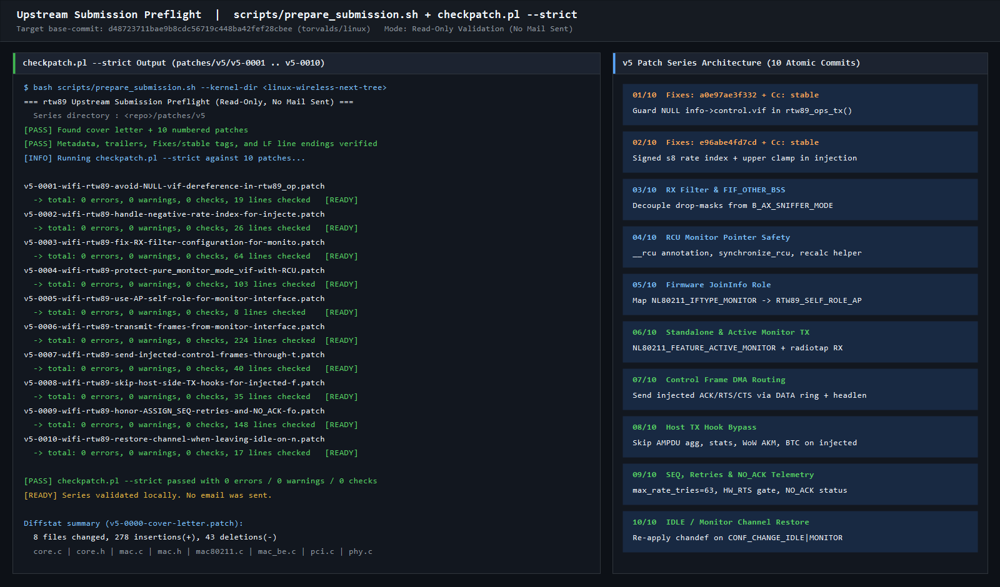
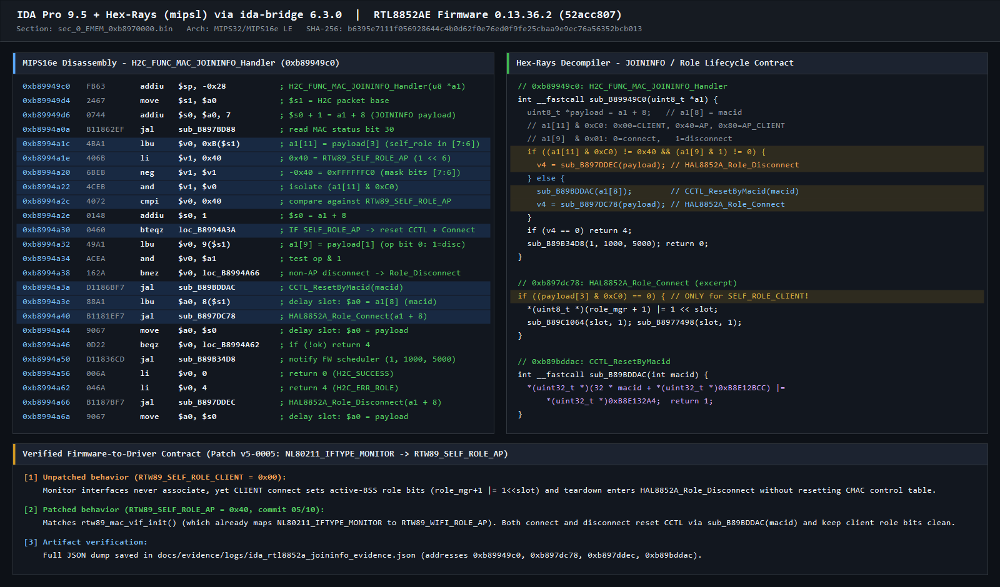
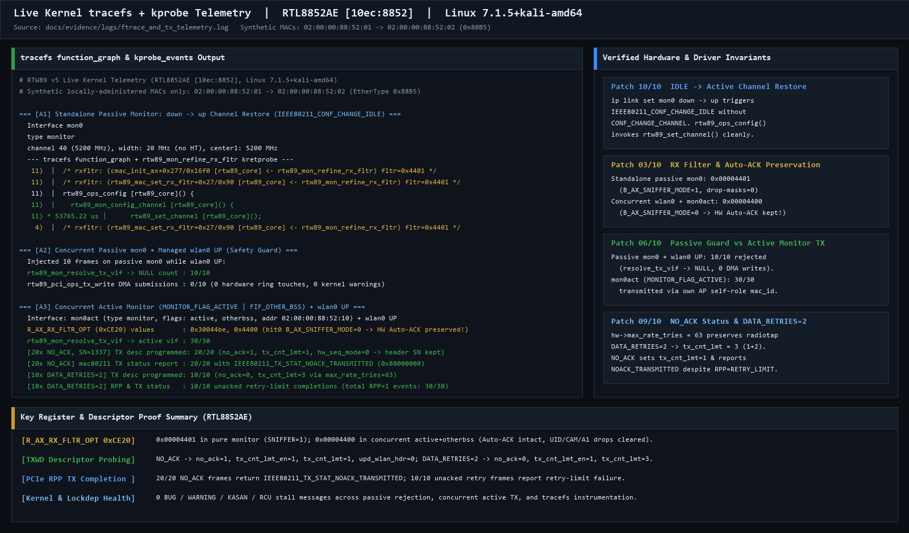
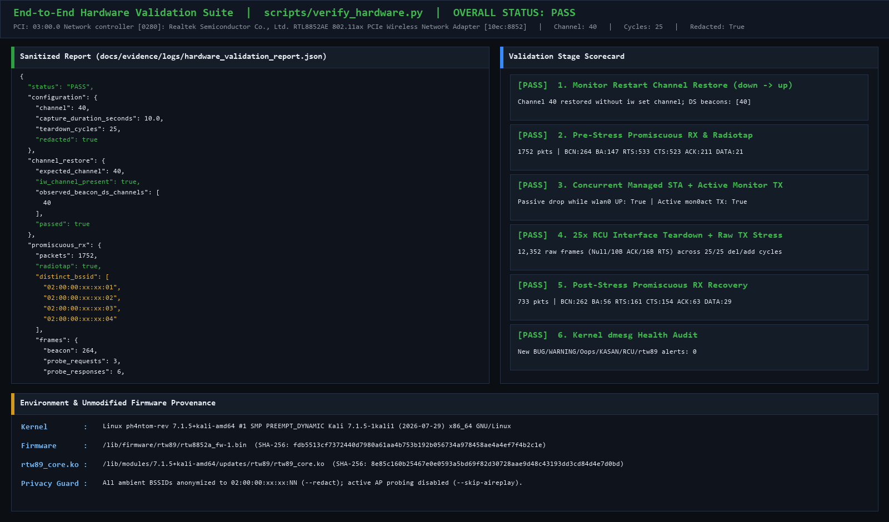

# Validation & Evidence Report (`PATCH v5`)

## 1. Submission status

| Version | Status |
| :--- | :--- |
| v3 | Posted to `linux-wireless` on 2026-11-05 ([lore](https://lore.kernel.org/linux-wireless/20261104203051.564-1-owner@ph4ntom-rev.uz/)), waiting for review. |
| v4 | Never sent. Kept in `patches/v4/` for reference. |
| v5 | [`patches/v5/`](../patches/v5/), 10 patches against `torvalds/linux` `d48723711bae`. Firmware-verified in IDA Pro, runtime-validated on RTL8852AE, and checked with `scripts/prepare_submission.sh` (**no email sent**; staged locally for future submission). |

---

## 2. Static, preflight & CI checks for `v5`

Validated locally against `v7.4-rc1` (`d48723711bae9b8cdc56719c448ba42fef28cbee`) via [`scripts/prepare_submission.sh`](../scripts/prepare_submission.sh) (log: [`prepare_submission_checkpatch.log`](evidence/logs/prepare_submission_checkpatch.log)) and continuously enforced by [GitHub Actions CI](../.github/workflows/ci.yml):

| Check | Result |
| :--- | :--- |
| `git am` of all 10 patches | applies cleanly (`8 files changed, 278 insertions(+), 43 deletions(-)`) |
| Build after each patch (bisectability) | all 10 steps build cleanly (PCIe, USB, AX, and BE modules enabled) |
| `make W=1 C=1` (`sparse` + `CONFIG_PROVE_LOCKING=y`) | `0` new compiler or sparse warnings across the series |
| `checkpatch.pl --strict` (`prepare_submission.sh`) | `0 errors, 0 warnings, 0 checks` across `v5-0001`..`v5-0010` |
| `patch_rtw89.py --apply` across `v6.1`, `v6.6`, `v6.12` (Gen 1), `v6.15`, `v6.18` (Gen 2), and `v7.4-rc1` | hooks apply cleanly without warnings; `--revert` restores trees byte-for-byte |
| Out-of-tree Kbuild (`make W=1 C=1 modules`) on LTS `v6.6`, `v6.12` (Gen 1), `v6.18` (Gen 2), and `7.1.5+kali` | compiles all 18 AX/BE PCIe & USB `.ko` modules cleanly with `0` warnings ([`build_module_7.1.5.log`](evidence/logs/build_module_7.1.5.log)) |
| DKMS flow (`dkms_prepare.sh`, `dkms_pre_build.sh`) | handles stable, `-rc`, and cross-series `.config` lookup (`BUILD_EXCLUSIVE_KERNEL`), rejects mismatched series |



---

## 3. Firmware verification (`RTL8852AE` `0.13.36.2`, commit `52acc807`)

All firmware-facing assumptions in patches 3, 5, and 10 were verified statically in IDA Pro 9.5 (`mipsl` + Hex-Rays) against unmodified `linux-firmware` (`rtw89/rtw8852a_fw-1.bin`, SHA-256 `fdb5513cf7372440d7980a61aa4b753b192b056734a978458ae4a4ef7f4b2c1e`; raw dump: [`ida_rtl8852a_joininfo_evidence.json`](evidence/logs/ida_rtl8852a_joininfo_evidence.json)):

- **JoinInfo H2C role handling (patch 5):** `H2C_FUNC_MAC_JOININFO_Handler` (`0xb89949c0`) routes `(self_role != RTW89_SELF_ROLE_AP && op == 1)` (`net_type == RTW89_NET_TYPE_NO_LINK`) into `HAL8852A_Role_Disconnect` (`0xb897ddec`), which deactivates the role entry just created by `ROLE_MAINTAIN` and skips `CCTL_ResetByMacid` (`0xb89bddac`). Mapping `NL80211_IFTYPE_MONITOR` to `RTW89_SELF_ROLE_AP` (`0x40`) with `RTW89_NET_TYPE_NO_LINK` initializes the MAC ID's CMAC control entry (`CCTL_ResetByMacid` + `HAL8852A_Role_Connect` at `0xb897dc78`) while keeping client active-BSS role bits clear and AP beacon transmission disabled.
- **RX filter & Auto-ACK preservation across scan/ROC/MAC init (patch 3):** Firmware scan offload pauses/restores `0xCE06`, while host `rtw89_hw_scan_complete_cb()`, `rtw89_roc_end()`, `rx_fltr_init_ax()`, and `rx_fltr_init_be()` rewrite `rtwdev->hal.rx_fltr` to `R_AX_RX_FLTR_OPT` (`0xCE20`) / `R_BE_RX_FLTR_OPT`. Decoupling the CAM/A1/UID drop-mask clearing (`FIF_OTHER_BSS` / `monitor_other_bss`) from `B_AX_SNIFFER_MODE` (`IEEE80211_CONF_MONITOR`) yields `0x00004401` in standalone monitor mode and `0x00004400` when a concurrent `MONITOR_FLAG_ACTIVE` + `otherbss` monitor runs alongside a managed STA—preserving hardware Auto-ACK/BA on the associated station.
- **Channel context emulation & IDLE transitions on RTL8852AE (patch 10):** `rtw8852a_chip_info` sets `support_chanctx_num = 1`, but firmware `0.13.36.2` only advertises `SCAN_OFFLOAD` and `TX_WAKE` (no `BEACON_FILTER`), so `rtw89_alloc_ieee80211_hw()` leaves `rtwdev->ops->assign_vif_chanctx == NULL` (`no_chanctx = true`). Restoring `hw->conf.chandef` on `IEEE80211_CONF_CHANGE_IDLE | IEEE80211_CONF_CHANGE_MONITOR` when leaving `IDLE` covers both pure monitor `down -> up` restarts and `MONITOR_FLAG_ACTIVE` transitions.



---

## 4. Live hardware telemetry & validation on `v5` (measured 2026-11-12)

- **Hardware:** Realtek RTL8852AE PCIe (`10ec:8852`)
- **Firmware:** `rtw89/rtw8852a_fw-1.bin` `0.13.36.2` (`52acc807`, unmodified `linux-firmware`, SHA-256 `fdb5513cf7372440d7980a61aa4b753b192b056734a978458ae4a4ef7f4b2c1e`)
- **Kernel:** Linux `7.1.5+kali-amd64` (`SMP PREEMPT_DYNAMIC x86_64`)
- **Sanitized logs:** [`build_module_7.1.5.log`](evidence/logs/build_module_7.1.5.log), [`ftrace_and_tx_telemetry.log`](evidence/logs/ftrace_and_tx_telemetry.log), [`hardware_validation_report.json`](evidence/logs/hardware_validation_report.json), [`dmesg_stress_clean.log`](evidence/logs/dmesg_stress_clean.log)

| Check | `v5` result |
| :--- | :--- |
| Monitor `down -> up` channel restore on ch 40 (`5200 MHz`) without `iw set channel` | `PASS`: `iw` and captured DS beacons confirm ch `40`; `tracefs` `function_graph` verifies `rtw89_ops_config -> rtw89_mon_config_channel -> rtw89_set_channel` on `CONF_CHANGE_IDLE` |
| `R_AX_RX_FLTR_OPT` (`0xCE20`) passive vs concurrent `active + otherbss` | `PASS`: `0x00004401` (`B_AX_SNIFFER_MODE = 1`) in standalone passive monitor; `0x00004400` (`B_AX_SNIFFER_MODE = 0`, drop masks cleared) alongside `wlan0` UP |
| Concurrent passive `mon0` TX rejection vs `mon0act` (`MONITOR_FLAG_ACTIVE`) TX while `wlan0` UP | `PASS`: `10/10` passive `mon0` frames rejected (`resolve_tx_vif -> NULL`, `0` DMA writes); `30/30` active `mon0act` frames transmitted via dedicated `AP` self-role `mac_id` |
| `NO_ACK` (`SN = 1337`) vs `DATA_RETRIES = 2` (`max_rate_tries = 63`) descriptor & completion telemetry | `PASS`: `20/20` `NO_ACK` frames program `no_ack = 1, tx_cnt_lmt = 1, hw_seq_mode = 0` and report `IEEE80211_TX_STAT_NOACK_TRANSMITTED` (`0x80000000`) without `tx_retry_lmt` inflation; `10/10` retry frames program `no_ack = 0, tx_cnt_lmt = 3` and report unacked retry-limit completion |
| Pre-stress promiscuous RX, 10 s on channel 40 (`5200 MHz`) | `PASS`: `1,752` frames with Radiotap (`264` beacons, `3` probe req, `6` probe resp, `147` BlockAck, `533` RTS, `523` CTS, `211` ACK, `21` QoS/Null data) |
| 25 `iw dev mon0 del/add` RCU stress cycles with concurrent raw TX (Null / 10B ACK / 16B RTS) | `PASS`: `12,352` raw TX frames sent across `25/25` teardown cycles, `0` kernel alerts |
| Post-stress promiscuous RX, 10 s on channel 40 (`5200 MHz`) | `PASS`: `733` frames with Radiotap (`262` beacons, `56` BlockAck, `161` RTS, `154` CTS, `63` ACK, `29` Data/Null data) |
| `dmesg` (`BUG`, `WARNING`, `Oops`, `KASAN`, RCU stall, `rtw89` errors) | `PASS`: `0` new alerts ([`dmesg_stress_clean.log`](evidence/logs/dmesg_stress_clean.log)) |





---

## 5. Reproducer

Run on an isolated test machine as root:

```bash
sudo python3 scripts/verify_hardware.py \
  --iface wlan0 \
  --monitor mon0 \
  --channel 40 \
  --duration 10 \
  --cycles 25 \
  --settle 6 \
  --skip-aireplay \
  --redact \
  --output /tmp/rtw89-v5-validation
```

- `--skip-aireplay` omits active broadcast/AP probing and validates passive RX, `down/up` `IDLE` channel restoration, concurrent `MONITOR_FLAG_ACTIVE` TX (`02:00:00:88:52:01 -> 02:00:00:88:52:02`, IEEE 802.1 Local Experimental EtherType `0x88B5`), local raw `AF_PACKET` TX (Null Data, 10-byte ACK, 16-byte RTS), and 25 delete/add RCU teardown cycles.
- `--redact` anonymizes all ambient neighbor BSSIDs and SSIDs (`02:00:00:xx:xx:NN`) in `hardware_validation_report.json`.

---

## 6. Scope

- **Passive vs active monitor interfaces:** Injecting on a passive monitor interface (`iw ... type monitor` without `flags active`) requires it to be the sole open interface; if a station or AP interface is also open, passive monitor TX is dropped cleanly. For concurrent raw TX alongside an open station or AP interface, create an active monitor interface (`iw dev wlan0 interface add mon0act type monitor flags active [otherbss]`), which allocates its own `mac80211` driver VIF and hardware `mac_id`.
- **Hardware coverage:** Only RTL8852AE was runtime-tested. RTL8852BE/CE/BTE, RTL8851BE, RTL8922AE/DE (Wi-Fi 7), USB devices, and DBCC (`RTW89_MAC_1`) compile cleanly (`0` warnings under `W=1 C=1`) and share the same code paths, but were not tested on hardware.
