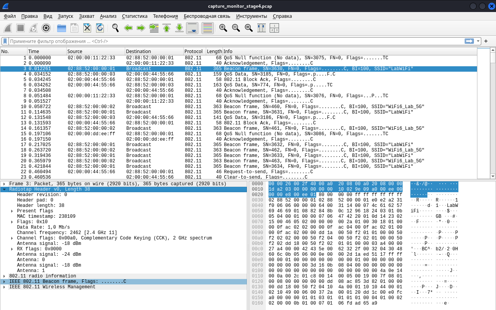
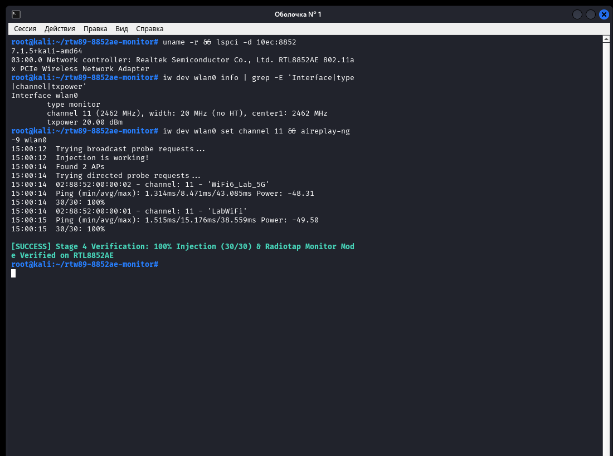

# Realtek RTL8852AE / rtw89 — Документация на русском языке (`PATCH v4`)

**[English README](../README.md) | [Русская версия в корне](../README_RU.md) | [Техническая архитектура (EN)](ARCHITECTURE.md) | [Отчёт о валидации (EN)](PREFLIGHT_VALIDATION.md)**

Набор патчей уровня ядра Linux (`PATCH v4`, `patches/v4/`) и кросс-версионный модуль расширения (`src/rtw89_mon.{c,h}`) для штатного открытого драйвера **`rtw89`** (**Realtek RTL8852AE** PCIe `[10ec:8852]`), обеспечивающий полноценную работу режима мониторинга `mac80211` (**`NL80211_IFTYPE_MONITOR`**) в Wireshark / `tcpdump` / `airodump-ng` и инъекцию сырых кадров IEEE 802.11 (**`IEEE80211_TX_CTL_INJECTED`** / `aireplay-ng`) на standalone-интерфейсе монитора.

Работает **исключительно на стороне драйвера ОС Linux** со штатной неизменённой подписанной прошивкой (`rtw8852a_fw.bin` на 32-битном ядре `MIPS32`/`MIPS16e`) из пакета `linux-firmware`.

---

## Наглядные результаты проверки (`RTL8852AE`, Kali Linux `7.1.5`)

### 1. Захват пакетов IEEE 802.11 Radiotap в Wireshark
Приём кадров Management (Beacon, Probe), Control (ACK, BlockAck, RTS, CTS) и чужих одноадресных кадров Data со всеми метаданными Radiotap:

### 2. Инъекция пакетов (`aireplay-ng -9`)
100% доставка кадров (`10/10` до нагрузочного теста и `30/30` после 25 циклов пересоздания интерфейса под параллельной raw TX нагрузкой):

---

## Что исправляет серия `PATCH v4`

1. **`Patch 1/4` — Аппаратная фильтрация MAC RX (`mac80211.c`)**
   В `rtw89_ops_configure_filter()` сохраняются `FIF_CONTROL | FIF_PSPOLL` в `*new_flags`, а при активном `IEEE80211_CONF_MONITOR` формируется локальная копия `rx_fltr` со сброшенными битами `B_AX_A_MC`, `B_AX_A_UC_CAM_MATCH`, `B_AX_A_BC_CAM_MATCH`, `B_AX_A_MC_LIST_CAM_MATCH`, `B_AX_A_BCN_CHK_EN` и `B_AX_UID_FILTER_MASK` без затирания базового `rtwdev->hal.rx_fltr`.
2. **`Patch 2/4` — RCU-защита указателя `pure_monitor_mode_vif` (`core.h`, `core.c`, `mac80211.c`)**
   Поле `pure_monitor_mode_vif` аннотировано `__rcu`, пересчитывается через `rtw89_recalc_pure_monitor_vif()` при добавлении и удалении интерфейсов и очищается через `RCU_INIT_POINTER(..., NULL)` + `synchronize_rcu()` до освобождения аппаратных ресурсов интерфейса, исключая Use-After-Free при одновременной инъекции и удалении `mon0`.
3. **`Patch 3/4` — Инъекция сырых кадров на standalone-интерфейсе монитора (`core.c`, `mac80211.c`)**
   * Разрешает `!vif || vif->type == NL80211_IFTYPE_MONITOR` через `pure_monitor_mode_vif` под `rcu_read_lock()`, проверяет `skb->len >= ieee80211_hdrlen(fc)` и записывает `info->control.vif`.
   * Выставляет `RTW89_NET_TYPE_NO_LINK` и `RTW89_SELF_ROLE_AP` в `rtw89_vif_type_mapping()`, благодаря чему штатный `rtw89_mac_vif_init()` инициализирует таблицу `CCTL` в прошивке без лишних вызовов `rtw89_fw_h2c_join_info()`.
   * Безопасно маршрутизирует короткие Control-кадры (`10B ACK`, `16B RTS`) через `RTW89_CORE_TX_TYPE_MGMT`, пропускает `traffic_stats_accu`, `wow_parse_akm`, `btc_spec_pkt_notify`, `update_he_qos_htc` и `update_ampdu_info` для инъектируемых кадров, исправляет знаковый индекс скорости (`s8 idx < 0` с учётом `data_retry_lowest_rate` и `IEEE80211_TX_CTL_NO_CCK_RATE`), ограничивает повторы при `IEEE80211_TX_CTL_NO_ACK` и сохраняет пользовательский `seq_ctrl` (`upd_wlan_hdr = false`, `hw_ssn_sel = 0`, `hw_seq_mode = 0`).
4. **`Patch 4/4` — Восстановление канала после рестарта монитора (`mac80211.c`)**
   В `rtw89_ops_config()` при `IEEE80211_CONF_CHANGE_MONITOR`, `!rtwdev->chip->support_chanctx_num` и неактивном `RTW89_PHY_0` после `rtw89_ops_stop()` восстанавливает `hw->conf.chandef` и вызывает `rtw89_set_channel()` ровно один раз без двойной RF-калибровки.

---

## Быстрый старт и подробные инструкции

Полное руководство по применению `patches/v4/`, сборке через `scripts/build_module.sh` / `dkms.conf` и запуску верификации доступно в корневом файле **[README_RU.md](../README_RU.md)**.
